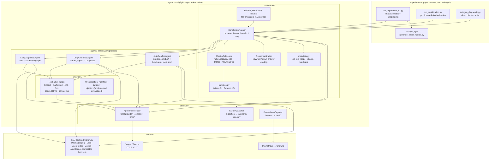
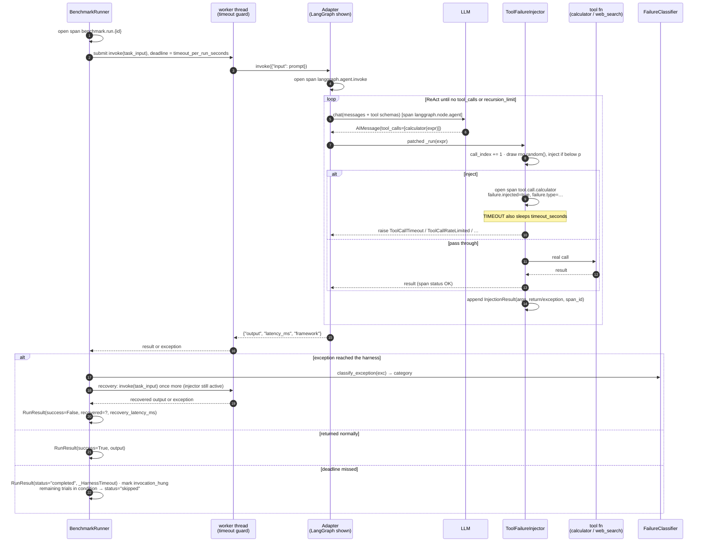
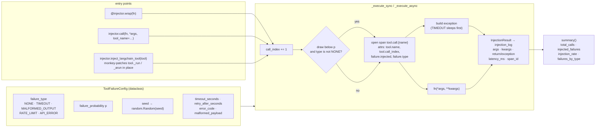
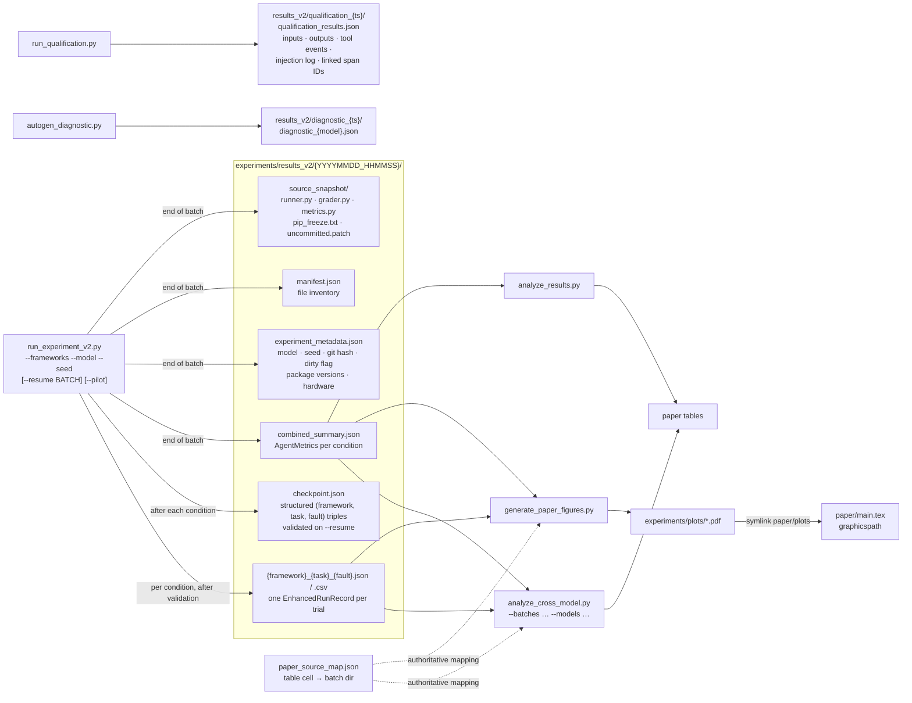
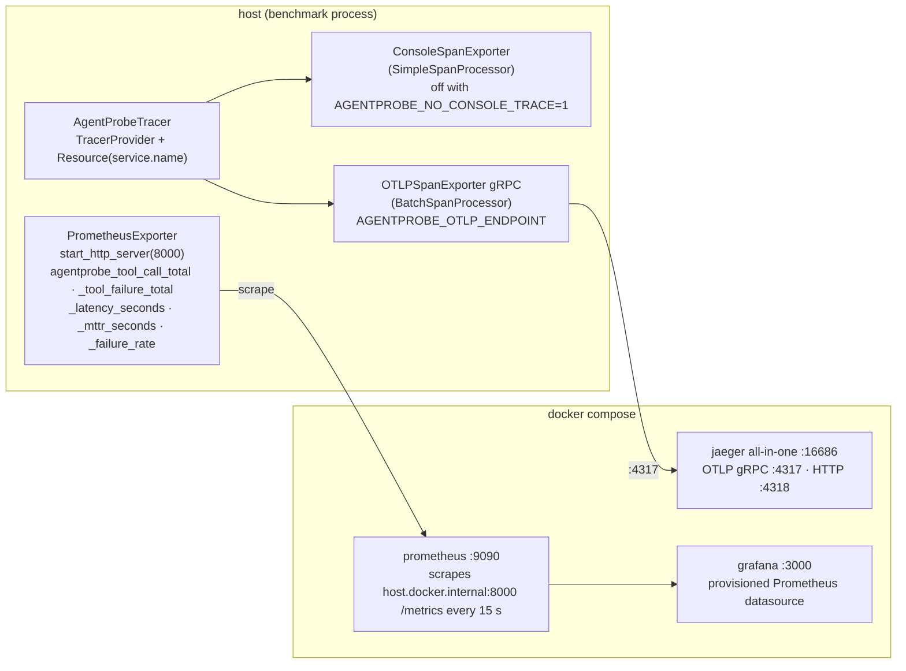
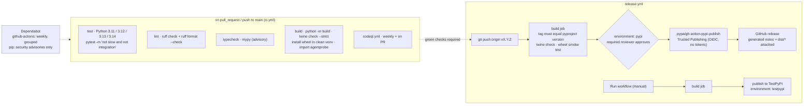

# Architecture

This document explains AgentProbe's internal design to help contributors navigate the codebase. Diagrams are [Mermaid](https://mermaid.js.org/) and render on GitHub; edit them in place when the code changes.

## 1. System overview

Four library layers plus the experiment harness that drives them. Only `agentprobe/` ships in the PyPI package; `experiments/` is the paper's harness and stays in the repo.



**Reading the diagram.** The experiment scripts never touch the frameworks directly: they build an adapter, hand it to `BenchmarkRunner`, and read back `RunResult` records. Each adapter creates its own `ToolFailureInjector` and wraps its tools with it, so injection happens identically regardless of framework. Every layer emits OpenTelemetry spans through the shared tracer.

## 2. One trial, end to end

What happens inside `BenchmarkRunner._run_single()` for a single run under injection. Span names are the real ones.



**Three things this diagram makes explicit.**

- *Injection is probabilistic per tool call, not per run.* `call_index` and the RNG are condition-wide, so `injector_calls` and `injector_injections` in the output are totals for the whole condition, never per trial.
- *Recovery is a harness-level retry.* The runner re-invokes the whole agent once with the injector still active. MTTR is the latency of that second invocation. It is not agent-internal self-repair.
- *A hung invocation poisons the rest of the condition.* Python threads cannot be killed, so after a deadline miss the runner skips the remaining trials rather than risk two concurrent invocations on one agent. Skipped trials are excluded from every metric.

## 3. Fault injection internals



All four fault types currently **raise** at the tool boundary. "Malformed output" therefore exercises the agent's exception path, not its parsing; returning corrupted-but-valid data is tracked in issue #28. Because every record carries the OTel `span_id`, a qualification run can prove that a specific injected fault appears in a specific trace.

## 4. Experiment data flow

How a batch directory is produced and consumed. File names are exact.



The Qwen2.5 column in the paper combines two batches (LangGraph/LangChain from one, AutoGen from a rerun with the corrected output extractor). `paper_source_map.json` is the only authoritative statement of which batch feeds which table cell; the analysis scripts do not merge batches on their own.

## 5. Observability stack

What `docker compose up -d` starts and how spans and metrics reach it.



Spans form a tree per trial: `benchmark.run.{id}` → `{framework}.agent.invoke` → `langgraph.node.agent` (per LLM call) and `tool.call.{name}` (per tool call, with `failure.injected` and `failure.type` attributes). The classifier can also run offline over finished spans via `FailureClassifier.classify_spans()`.

## 6. CI and release pipeline



The version lives in three files (`pyproject.toml`, `agentprobe/__init__.py`, `CITATION.cff`) and `tests/test_public_api.py` fails if they disagree, so a mismatched tag cannot get past the build job.

## Core modules

### `agentprobe/agents/` — framework adapters

Each adapter wraps a specific agent framework behind the `BaseAgent` protocol in `agents/base.py`:

```python
framework: str
invoke(input: dict) -> dict      # input["input"] is the query; returns {"output", "latency_ms", "framework", ...}
reset() -> None                  # clear conversation state (never the injector)
get_injector_summary() -> dict   # condition-wide injection stats
```

All adapters accept the same tools (calculator, web_search) and the same LLM configuration. The adapter translates between the framework's native API and AgentProbe's common interface.

`LangChainToolAgent` is built on `langchain.agents.create_agent`, which compiles to a LangGraph graph internally. The two adapters therefore share an execution path, which is why the paper reports identical LangGraph/LangChain failure patterns. `AutoGenToolAgent` targets `pyautogen 0.1.14` and installs a one-time monkey-patch that converts the legacy `functions` request format to `tools` and the `tool_calls` response back to `function_call`, because Ollama silently ignores the legacy format (the Phase 1 "tool bypass" finding).

**Adding a new framework:** write a class that satisfies `BaseAgent` (it is a structural `Protocol`, no subclassing needed), wrap your tools with `ToolFailureInjector`, and register the class in `build_agent()` in `experiments/run_experiment_v2.py`.

### `agentprobe/injector/` — fault injectors

`ToolFailureInjector` is the one used in every experiment (Section 3). `OrchestrationFailureInjector`, `ContextFailureInjector`, and `LatencyFailureInjector` are implemented and unit-tested but have not been used in a published experiment (issues #24, #25).

**Key design choice:** injectors are stateful (call count, RNG, log) but the RNG is seeded, so the injection sequence is reproducible regardless of framework-internal randomness.

### `agentprobe/benchmark/` — experiment infrastructure

```
runner.py      — BenchmarkRunner, RunResult, BenchmarkConfig, PAPER_PROMPTS / paper_task_fn
metrics.py     — MetricsCalculator → AgentMetrics (failure/recovery rate, MTTR, percentiles)
statistics.py  — Wilson CIs, Cohen's d/h, comparison reports
grader.py      — ResponseGrader: keyword and exact-answer grading, silent-failure detection
tasks/         — graded query corpora (25 tool_use, 15 rag, 15 multi_agent); NOT the paper's prompts
metadata.py    — ExperimentMetadata capture (model, seed, git commit, pip freeze, hardware)
```

**Two prompt sets.** The runner's default `task_fn` is `paper_task_fn`, which cycles the five prompts per task in `runner.PAPER_PROMPTS`. Every batch reported in the paper used this set. The larger graded corpora are available via `corpus_task_fn(task)` but have not been used in a published experiment.

**Metric definitions.** "Failure" means the agent invocation raised an exception that reached the harness. "Recovery" means the harness's single re-invocation succeeded. MTTR is the mean latency of successful re-invocations. P99 is ceiling nearest-rank, so for n < 100 it equals the sample maximum. `recovery_rate` is `None` when a condition had no failures.

### `agentprobe/llm.py` — provider-agnostic backends

`LLMSpec` describes a backend (provider preset, exact model id, endpoint, key *variable*, throttle, retries); `build_chat_model()` returns the LangChain model for the LangGraph/LangChain adapters and `autogen_llm_config()` the `llm_config` for AutoGen. Every experiment script takes the same `--provider …` flags via `add_llm_args()`; the default is the paper's local Ollama. `is_llm_backend_error()` is what lets the runner keep provider-side 429/5xx events (recorded as `status="backend_error"`, excluded from metrics) apart from *injected* tool faults.

### `agentprobe/observer/` — observability

```
tracer.py      — AgentProbeTracer: OTel provider setup; get_tracer() for library modules
classifier.py  — FailureClassifier: exception name / span attributes → 5-category taxonomy; Jaccard consistency check
dashboard.py   — PrometheusExporter: counters, gauges, histogram on /metrics
```

The classifier is rule-based and is used by the runner to label `failure_category`; it is not used for the paper's headline metrics.

## Key design decisions

1. **Adapters, not plugins.** Each framework adapter is a concrete class. Simple and debuggable at the cost of a code change to add a framework.
2. **Injection at the tool boundary.** Faults wrap tool functions, not LLM responses or framework internals, so injection behaves identically across frameworks.
3. **Seeded RNG per injector, condition-wide state.** Reproducible sequences; totals are per condition.
4. **Checkpoint-based resume with validation.** The checkpoint stores structured `(framework, task, fault_type)` triples, and resume refuses to continue if record counts, run IDs, or metadata (model, seed, n_runs) disagree with what is on disk.
5. **Metrics are pure computation.** `MetricsCalculator` takes a list of run results and returns metrics. No side effects, easy to test.
6. **Library and harness are separate.** Only `agentprobe/` is packaged; experiment scripts import it like any user would.

## Testing

```
tests/
├── test_public_api.py             — public exports, BaseAgent protocol, config/injector compatibility, version sync
├── test_tool_failure.py           — injection probability and fault types
├── test_benchmark_runner.py       — runner orchestration, timeout handling
├── test_metrics.py                — metrics computation edge cases
├── test_experiment_state.py       — checkpoint validation and resume safety
├── test_pilot_hung.py             — hung invocation detection
├── test_qualification_checker.py  — answer validation logic
├── test_metadata.py               — metadata capture
└── ...                            — classifier, grader, statistics, tasks, tracer, other injectors
```

Tests use mocked agents and tools — no LLM calls required. Run with `pytest tests/ -v`.
