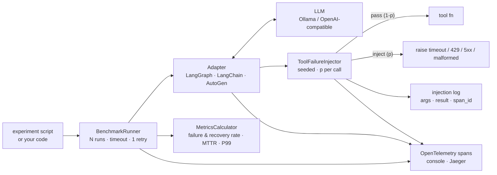

# Research: the benchmark and the paper

This folder holds the research side of AgentProbe: the benchmark harness, the experiment data and the paper behind it. If you want to test your own agent, start with the [main README](../README.md) instead.

| Folder | Contents |
|---|---|
| [`experiments/`](experiments/) | Benchmark and experiment scripts, and every result batch used in the paper (`results_v2/`, with Phase 1 archived in `archive_v1/`) |
| [`paper/`](paper/) | LaTeX source of the manuscript and its figures |
| [`samples/`](samples/) | A multi-framework sample agent built as an AgentProbe test target |
| [`observability/`](observability/) | Docker Compose stack (Prometheus, Grafana, Jaeger) for watching benchmark runs |

All commands below are run from the repository root.

AgentProbe began as the toolkit behind the paper *"AgentProbe: Systematic Fault Injection and Observability for Evaluating the Reliability of LLM-Based Intelligent Agents"* (submitted to MAKE, MDPI, 2026). The benchmark side runs agents many times under seeded, probabilistic faults and reports failure rate, recovery rate, MTTR and latency percentiles across LangGraph, LangChain and AutoGen. Everything below documents that toolkit and how to reproduce the paper.

```bash
# From a clone, for development or to run the paper's experiments
git clone https://github.com/chhayankjain/agentprobe-toolkit.git && cd agentprobe-toolkit
pip install -e ".[dev,plotting,ollama]"

# The AutoGen adapter targets pyautogen 0.1.14 and needs openai<1.0, which
# conflicts with langchain-openai. Install it in its own environment:
#   pip install "agentprobe-toolkit[ollama,autogen]"
```

## Failure taxonomy

AgentProbe organises agent failures into five categories. Only the first has been exercised in a published experiment; the status column says exactly what exists for each.

| # | Category | Examples | Status in this repo |
|---|----------|----------|---------------------|
| 1 | **Tool Call** | API timeouts, malformed output, rate limits (HTTP 429), server errors (5xx) | Injector implemented, **used in all paper experiments** (`injector/tool_failure.py`) |
| 2 | **Orchestration** | Infinite loops, wrong branching, state corruption, dropped handoffs | Injector implemented and unit-tested, not yet used in an experiment (`injector/orchestration_failure.py`) |
| 3 | **Context** | Context window overflow, lost history, hallucinated history | Injector implemented and unit-tested, not yet used in an experiment (`injector/context_failure.py`) |
| 4 | **Latency** | P99 spikes, cascading slowdowns, jitter | Injector implemented; latency in the paper is a by-product of tool faults, not independently injected (`injector/latency_failure.py`) |
| 5 | **Consistency** | Non-deterministic outputs, divergent multi-agent state | Detected only, via a Jaccard-similarity classifier; nothing is injected (`observer/classifier.py`) |

Note that the current "malformed output" injector raises an exception at the tool boundary rather than returning corrupted data to the model, so it tests the agent's exception path, not its parsing. See issue [#28](https://github.com/chhayankjain/agentprobe-toolkit/issues/28).

## Benchmark quick start (Ollama)

```bash
# Start Ollama with Llama 3.1 (used in all paper experiments)
ollama pull llama3.1

# For cross-model validation (optional)
# ollama pull mistral:7b
# ollama pull qwen2.5:7b

# Run baseline benchmark (no failures)
python research/experiments/run_benchmarks.py --frameworks langgraph --tasks tool_use --baseline-only

# Run with failure injection
python research/experiments/run_benchmarks.py \
    --frameworks langgraph langchain \
    --tasks tool_use rag \
    --failure-types none timeout rate_limit \
    --n-runs 50 \
    --save-results
```

## Benchmark API

```python
from langchain_ollama import ChatOllama

from agentprobe import (
    AgentProbeTracer,
    BenchmarkConfig,
    BenchmarkRunner,
    MetricsCalculator,
    ToolFailureConfig,
    ToolFailureType,
)
from agentprobe.agents.langgraph_agent import LangGraphToolAgent

# 1. Set up tracing (console by default; OTLP endpoint optional)
tracer = AgentProbeTracer(service_name="my-experiment", otlp_endpoint="http://localhost:4317")

# 2. Configure failure injection
failure_config = ToolFailureConfig(
    failure_type=ToolFailureType.TIMEOUT,
    failure_probability=0.2,    # 20% of tool calls will time out
    timeout_seconds=5.0,
    seed=42,                    # reproducible injection sequence
)

# 3. Build an agent; it wraps its tools with a ToolFailureInjector internally
llm = ChatOllama(model="llama3.1", temperature=0.0)
agent = LangGraphToolAgent(llm=llm, failure_config=failure_config)

# 4. Run the benchmark (defaults to the paper's five-prompt set)
config = BenchmarkConfig(
    framework="langgraph",
    task="tool_use",
    n_runs=50,
    failure_config=failure_config,
    recovery_attempts=1,
    save_results_path="research/experiments/results/langgraph_tool_use_timeout",
)
results = BenchmarkRunner(agent=agent, config=config).run()

# 5. Compute metrics
metrics = MetricsCalculator().compute(results)
print(f"Failure rate: {metrics.failure_rate:.1%}")
print(f"Recovery rate: {metrics.recovery_rate}")
print(f"MTTR: {metrics.mttr_ms:.0f}ms")
print(f"P99 latency: {metrics.p99_latency_ms:.0f}ms")
print(agent.get_injector_summary())
```

#### Probabilistic injectors (lower-level API)

The injector is framework-agnostic. Wrap any callable, or any LangChain `BaseTool`:

```python
from agentprobe import ToolFailureConfig, ToolFailureInjector, ToolFailureType

injector = ToolFailureInjector(
    ToolFailureConfig(failure_type=ToolFailureType.RATE_LIMIT, failure_probability=0.3, seed=7)
)

@injector.wrap
def lookup_price(sku: str) -> float:
    ...

faulty_tool = injector.inject_langchain_tool(my_langchain_tool)   # in-place, keeps schema
print(injector.summary())        # total_calls, injected_failures, failures_by_type, ...
print(injector.injection_log)    # one record per call with args, return/exception, span_id
```

#### Two prompt sets

- **Paper prompts (default).** `BenchmarkRunner` cycles the five prompts per task in `agentprobe.benchmark.runner.PAPER_PROMPTS`. Every batch in the paper used these.
- **Graded corpora.** `agentprobe.benchmark.tasks` holds 25 tool-use, 15 RAG, and 15 multi-agent queries with keyword graders. They have not been used in a published experiment. Run them with `task_fn=corpus_task_fn("tool_use")` or `run_benchmarks.py --query-set corpus`.

#### Metric definitions

- **Failure**: the agent invocation raised an exception that reached the harness. A wrong-but-exception-free answer is *not* a failure here; use the grader for that.
- **Recovery**: the harness re-invoked the agent once (injector still active) and that call succeeded. This is a harness-level retry, not agent-internal self-repair.
- **MTTR**: mean latency of successful re-invocations, in ms.
- **P50/P90/P99**: ceiling nearest-rank percentiles of per-run latency. For n < 100, P99 equals the sample maximum. Injected timeouts sleep for real, so latency under the timeout condition includes the injected delay.
- **Recovery rate** is `None` when a condition had no failures.

## Architecture



Full diagrams (per-trial sequence, injector internals, data flow, observability stack, CI/release) are in [ARCHITECTURE.md](https://github.com/chhayankjain/agentprobe-toolkit/blob/main/ARCHITECTURE.md).

```
agentprobe/
├── injector/
│   ├── tool_failure.py          # Category 1: tool call failures
│   ├── orchestration_failure.py # Category 2: orchestration failures
│   ├── context_failure.py       # Category 3: context failures
│   └── latency_failure.py       # Category 4: latency failures
├── observer/
│   ├── tracer.py                # OpenTelemetry setup + span utilities
│   ├── classifier.py            # Rule-based failure classification
│   └── dashboard.py             # Prometheus metrics exporter
├── benchmark/
│   ├── runner.py                # BenchmarkRunner + PAPER_PROMPTS (the paper's prompt set)
│   ├── tasks/                   # Larger graded corpora (not used in the paper)
│   ├── metrics.py               # Failure rate, recovery rate, MTTR, percentiles
│   ├── grader.py                # Keyword / answer-presence grading
│   ├── statistics.py            # Wilson CIs, Cohen's d/h, comparisons
│   └── metadata.py              # Reproducibility metadata capture
└── agents/
    ├── base.py                  # BaseAgent protocol: invoke(dict) -> dict, reset()
    ├── langgraph_agent.py       # LangGraph ReAct agent
    ├── langchain_agent.py       # LangChain create_agent (compiles to LangGraph internally)
    └── autogen_agent.py         # AutoGen two-agent pipeline (pyautogen 0.1.14 + compat shim)
```

See [ARCHITECTURE.md](https://github.com/chhayankjain/agentprobe-toolkit/blob/main/ARCHITECTURE.md) for design decisions.

## Observability stack

```bash
# Start Prometheus + Grafana + Jaeger
docker compose -f research/observability/docker-compose.yml up -d

# Grafana:    http://localhost:3000  (admin/admin)
# Jaeger:     http://localhost:16686
# Prometheus: http://localhost:9090
```

```python
from agentprobe.observer.dashboard import PrometheusExporter

exporter = PrometheusExporter(port=8000)
exporter.start()  # /metrics on :8000

# Auto-record from benchmark run
exporter.record_benchmark_run(results)
```

## Supported frameworks and LLM backends

| Framework | Adapter | Validated in paper | Notes |
|-----------|---------|--------------------|-------|
| LangGraph | `LangGraphToolAgent` | Yes (Llama 3.1, Mistral 7B, Qwen2.5 7B) | Hand-built ReAct graph |
| LangChain | `LangChainToolAgent` | Yes (same models) | Uses `create_agent`, which compiles to LangGraph; shares an execution path with the LangGraph adapter, so results converge |
| AutoGen | `AutoGenToolAgent` | Yes, with caveats | Targets **pyautogen 0.1.14** through a `functions`→`tools` compatibility shim. Phase 1 found it silently bypassed tools; Phase 2 patched that. Modern `ag2` / `autogen-agentchat` 0.4+ is not yet supported ([roadmap](https://github.com/chhayankjain/agentprobe-toolkit/issues/38)) |

| LLM Backend | `--provider` | Install extra | Validated in paper | Notes |
|-------------|--------------|---------------|--------------------|-------|
| Ollama (Llama 3.1 8B, Mistral 7B, Qwen2.5 7B, Q4_K_M) | `ollama` (default) | `.[ollama]` | Yes | Local, zero API cost. Every number in the paper comes from this backend |
| Any OpenAI-compatible server (vLLM, LM Studio, llama.cpp, ...) | `openai-compatible --base-url …` | `.[openai]` | **No** | |
| OpenAI | `openai` | `.[openai]` | **No** | `OPENAI_API_KEY` |
| Groq | `groq` | `.[openai]` | **No** | `GROQ_API_KEY`; free tier is token-per-day limited, use `--rpm` |
| OpenRouter | `openrouter` | `.[openai]` | **No** | `OPENROUTER_API_KEY`; `:free` models share a low daily cap |
| Cerebras | `cerebras` | `.[openai]` | **No** | `CEREBRAS_API_KEY` |
| Mistral | `mistral` | `.[openai]` | **No** | `MISTRAL_API_KEY` |
| GitHub Models | `github` | `.[openai]` | **No** | `GITHUB_TOKEN` with the `models` permission |
| Google AI Studio (Gemini), AutoGen adapter | `gemini` | none | **No** | `GEMINI_API_KEY`, via Google's OpenAI-compatible endpoint; works with pyautogen's legacy client |
| Google AI Studio (Gemini), LangGraph/LangChain adapters | `google` | `.[google]` | **No** | `GEMINI_API_KEY`, native `langchain-google-genai`. Required for Gemini 3 models: their tool calls carry thought signatures that the OpenAI-compatible endpoint drops on the second turn (HTTP 400) |
| Anthropic (Claude) | `anthropic` | `.[anthropic]` | **No** | `ANTHROPIC_API_KEY`; LangGraph/LangChain adapters only |

#### Hosted backends

Every experiment script (`run_experiment_v2.py`, `run_qualification.py`, `run_benchmarks.py`, `smoke_test_model.py`, `autogen_diagnostic.py`) takes the same flags, defined in `agentprobe.llm`:

```bash
# Default: identical to the paper's runs
python research/experiments/run_experiment_v2.py --model llama3.1

# Groq free tier, throttled to stay under the daily token budget
export GROQ_API_KEY=...
python research/experiments/smoke_test_model.py --provider groq --model llama-3.3-70b-versatile --frameworks langgraph
python research/experiments/run_experiment_v2.py --provider groq --model llama-3.3-70b-versatile --rpm 25 \
    --frameworks langgraph langchain

# Google AI Studio: native client for LangGraph/LangChain, OpenAI-compatible endpoint for AutoGen
export GEMINI_API_KEY=...
python research/experiments/run_experiment_v2.py --provider google --model gemini-flash-lite-latest --rpm 10 --frameworks langgraph langchain
python research/experiments/run_experiment_v2.py --provider gemini --model gemini-flash-lite-latest --rpm 10 --frameworks autogen

# Anything OpenAI-compatible
python research/experiments/run_experiment_v2.py --provider openai-compatible --base-url http://localhost:8000/v1 \
    --api-key-env VLLM_KEY --model my-model
```

Flags: `--provider`, `--model`, `--base-url`, `--api-key-env`, `--rpm` (client-side throttle), `--max-retries` (client retries on 429/5xx/timeouts, default 6), `--llm-timeout`.

Three things the harness does for hosted runs:

- **Backend errors are not agent failures.** A provider-side 429, 5xx, or connection error that survives client retries is re-dispatched by the runner (`backend_error_retries`, default 2, with backoff), and if it still fails the trial is recorded as `status="backend_error"` with category `infrastructure` and **excluded from every metric**. It is never confused with an *injected* `ToolCallRateLimited`. Conditions with backend errors are marked incomplete.
- **Exact backend is recorded.** `experiment_metadata.json` gains `llm_provider`, `model_id`, `llm_base_url`, `llm_api_key_env` (the variable *name*, never the key), `llm_requests_per_minute`, so a batch says which hosted model produced it. `--resume` refuses a batch whose provider or endpoint changed.
- **Backend errors are recognised at the model call, not by exception type.** A tool that fails with the same transport error (`httpx.ReadTimeout`, a 503 from a real service) is a measured agent failure. If you write your own agent, wrap each model call in `agentprobe.llm.llm_call_boundary()` to get the same separation.
- **AutoGen runs one tool call per turn.** A turn that requests several parallel calls is recorded as a `harness_error` and excluded, rather than silently running only the first.
- **AutoGen works with any OpenAI-compatible provider** through `api_base`, so hosted AutoGen runs need no extra packages. LangGraph/LangChain hosted runs need `langchain-openai` (`openai>=1`), which conflicts with the `[autogen]` extra (`openai<1`): use a separate environment for those.

Hosted models change silently and are not seed-reproducible; treat hosted batches as a snapshot, not a replication of the paper.

Free-tier notes from testing (November 2026): Google AI Studio's `gemini-3-flash-preview` allows 20 requests per day per project, enough for a smoke test but not a batch; the `*-flash-lite` models have separate, larger quotas, shown only inside AI Studio. Google now issues keys starting with `AQ.` as well as `AIza`. Groq's free tier is capped by tokens per day. Check the per-model quota in the provider console before launching a 450-run batch.

## Reproducing the paper's results

The paper reports a two-phase study using Llama 3.1 8B (Q4_K_M) via Ollama, with injection seed 42 throughout.

#### Phase 1 — Discovery (1,050 runs)

Phase 1 uses `run_benchmarks.py` with 30 runs for LangGraph/LangChain and 10 for AutoGen across 3 task types and 5 fault conditions. This phase discovered that AutoGen never invokes tools due to a legacy API-parameter mismatch.

> **Historical reproduction note:** The current codebase includes the patched AutoGen adapter (`_patch_openai_compat()`). To reproduce the original Phase 1 bypass behavior, use the pre-patch source at tag `v1.0.0`. Running Phase 1 commands with the current code will produce patched AutoGen behavior (tools are called), not the historical bypass.

```bash
# LangGraph / LangChain (30 runs per condition)
python research/experiments/run_benchmarks.py \
    --frameworks langgraph langchain \
    --tasks tool_use rag multi_agent \
    --failure-types none timeout malformed_output rate_limit api_error \
    --n-runs 30 --provider ollama --model llama3.1 --save-results

# AutoGen (10 runs per condition)
python research/experiments/run_benchmarks.py \
    --frameworks autogen \
    --tasks tool_use rag multi_agent \
    --failure-types none timeout malformed_output rate_limit api_error \
    --n-runs 10 --provider ollama --model llama3.1 --save-results
```

#### Phase 2 — Patched Validation (450 runs)

Phase 2 uses `run_experiment_v2.py` with the patched AutoGen adapter (proper `tool_name=` recording, `_patch_openai_compat()` for the functions/tools protocol gap). Runs 30 trials per condition across 3 frameworks × 5 fault conditions on tool-use tasks only, with matched p=0.20 injection probability.

```bash
python research/experiments/run_experiment_v2.py \
    --frameworks langgraph langchain autogen \
    --model llama3.1 --seed 42
```

#### Qualification Experiment (12 trials)

A small, targeted validation with deterministic calculator tasks and guaranteed fault injection (p=1.0). Produces a self-contained JSON artifact with inputs, outputs, tool events, injection log entries (with args/returns), and linked OTel trace span IDs.

```bash
python research/experiments/run_qualification.py \
    --frameworks langgraph langchain autogen \
    --model llama3.1
```

#### Cross-Model Validation

Repeats the qualification and Phase 2 protocol on additional models (Mistral 7B, Qwen2.5 7B):

```bash
# Smoke test: verify tool calling works
python research/experiments/smoke_test_model.py --model mistral:7b
python research/experiments/smoke_test_model.py --model qwen2.5:7b

# Qualification (12 trials per model)
python research/experiments/run_qualification.py --model mistral:7b
python research/experiments/run_qualification.py --model qwen2.5:7b

# Full Phase 2 (450 runs per model)
python research/experiments/run_experiment_v2.py --model mistral:7b --seed 42
python research/experiments/run_experiment_v2.py --model qwen2.5:7b --seed 42

# Cross-model analysis
python research/experiments/analyze_cross_model.py \
    --batches research/experiments/results_v2/20261111_113514 research/experiments/results_v2/20261111_233435 research/experiments/results_v2/20261112_040156 \
    --models llama3.1 mistral:7b qwen2.5:7b
```

Results are saved to `research/experiments/results_v2/`.

#### AutoGen Diagnostic (Direct Client vs Shim)

A diagnostic comparing the AutoGen adapter pipeline against a direct OpenAI-compatible client on the same three deterministic tasks. The compared paths differ in message format, stopping policy, and temperature handling; results are consistent with the adapter layer being a major contributor to low answer-string presence but do not isolate a single cause:

```bash
# Llama 3.1
python research/experiments/autogen_diagnostic.py --model llama3.1

# Qwen2.5 7B
python research/experiments/autogen_diagnostic.py --model qwen2.5:7b
```

Diagnostic artifacts are saved to `research/experiments/results_v2/diagnostic_*/`.

#### Analysis

Phase 2 uses the corrected summaries under `research/experiments/results_v2/`. The original Phase 1 output (now at `research/experiments/archive_v1/results/combined_summary.json`) contains known counting bugs and is kept only for the historical record. The paper's tables are derived from:
- **Phase 2 batch (Llama 3.1):** `research/experiments/results_v2/20261111_113514/`
- **Phase 2 batch (Mistral 7B):** `research/experiments/results_v2/20261111_233435/`
- **Phase 2 batch (Qwen2.5 7B LG/LC):** `research/experiments/results_v2/20261112_040156/`
- **Phase 2 batch (Qwen2.5 7B AutoGen rerun):** `research/experiments/results_v2/20261112_063451/` (corrected extractor)
- **Qualification (Llama 3.1):** `research/experiments/results_v2/qualification_20261111_211913/` (12 trials, 10 passed)
- **Qualification (Mistral 7B):** `research/experiments/results_v2/qualification_20261111_233116/` (12 trials, 8 passed)
- **Qualification (Qwen2.5 7B):** `research/experiments/results_v2/qualification_20261111_233320/` (12 trials, 10 passed)

> **Source map:** The authoritative mapping from each paper table cell to its batch directory is in [`research/experiments/results_v2/paper_source_map.json`](https://github.com/chhayankjain/agentprobe-toolkit/blob/main/experiments/results_v2/paper_source_map.json). The Qwen2.5 column combines two batches: LangGraph/LangChain from `20261112_040156` and AutoGen from `20261112_063451` (corrected output extractor). Llama and Mistral use their single original batches. The `analyze_cross_model.py` script does not automatically merge these; use the source map to select the correct batch per framework.

> **Model digests:** All three models use Q4_K_M quantization. Ollama digest prefixes: Llama `46e0c10c039e`, Mistral `6577803aa9a0`, Qwen `845dbda0ea48`. The `experiment_metadata.json` files in historical batches record `model_digest: unknown` because digest capture was added after the experiments ran; the digests listed here were identified post-hoc from the same Ollama installation.
